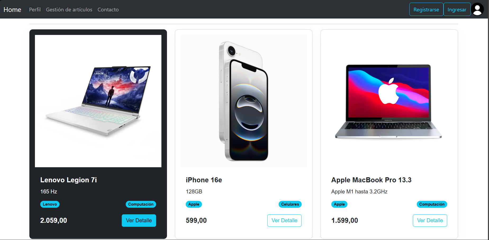

# 🟪 Web Catalog

A web application built with **ASP.NET Web Forms** to manage an online product catalog.

  
  
  
  
  

<table>
  <tr>
    <td width="55%" valign="top">
      <h2>🖥️ About the Project</h2>
      

        Web Catalog is an online catalog with an administration panel for managing products.
        It includes user and admin roles, product search, and dynamic filtering.
        The application follows a layered architecture and connects to SQL Server using stored procedures.
      

      <!-- Add your actual screenshot at images/web-catalog.png. -->
      

        
      

      <h2>📁 Project Structure</h2>
      <pre>Web-Catalog/
├── AppFinal/           # ASP.NET Web Forms application
├── Control/            # Application logic
├── Model/              # Data access and models
├── README.md
└── TPFinalNivel3_CarranzaFabricio.sln</pre>
    </td>
    <td width="45%" valign="top">
      <h2>⚙️ Features</h2>
      <ul>
        <li>Product management (create, read, update, delete)</li>
        <li>Role-based authentication (user/admin)</li>
        <li>Administrative panel</li>
        <li>Dynamic filters and advanced search</li>
        <li>SQL Server database integration</li>
      </ul>
      <h2>🛠️ Technologies</h2>

   &nbsp; <strong>C#</strong>

   &nbsp; <strong>ASP.NET Web Forms / .NET Framework 4.8</strong>

   &nbsp; <strong>SQL Server</strong>

   &nbsp; <strong>Bootstrap, HTML &amp; CSS</strong>

      <h2>🚀 Getting Started</h2>
      <ol>
        <li>Clone the repository.</li>
        <li>Open <code>TPFinalNivel3_CarranzaFabricio.sln</code> in Visual Studio on Windows.</li>
        <li>Set up the SQL Server database <code>CATALOGO_WEB_DB</code>, including its required tables and stored procedures.</li>
        <li>Update the <code>cadenaConexion</code> connection string in <code>AppFinal/Web.config</code>.</li>
        <li>Run the web application using Visual Studio (F5).</li>
      </ol>
    </td>
  </tr>
</table>

### 🔗 Links

- **[Live App](http://nicodevwebcatalog.somee.com)**
- **[Source Code](https://github.com/nicodev404/Web-Catalog)**
